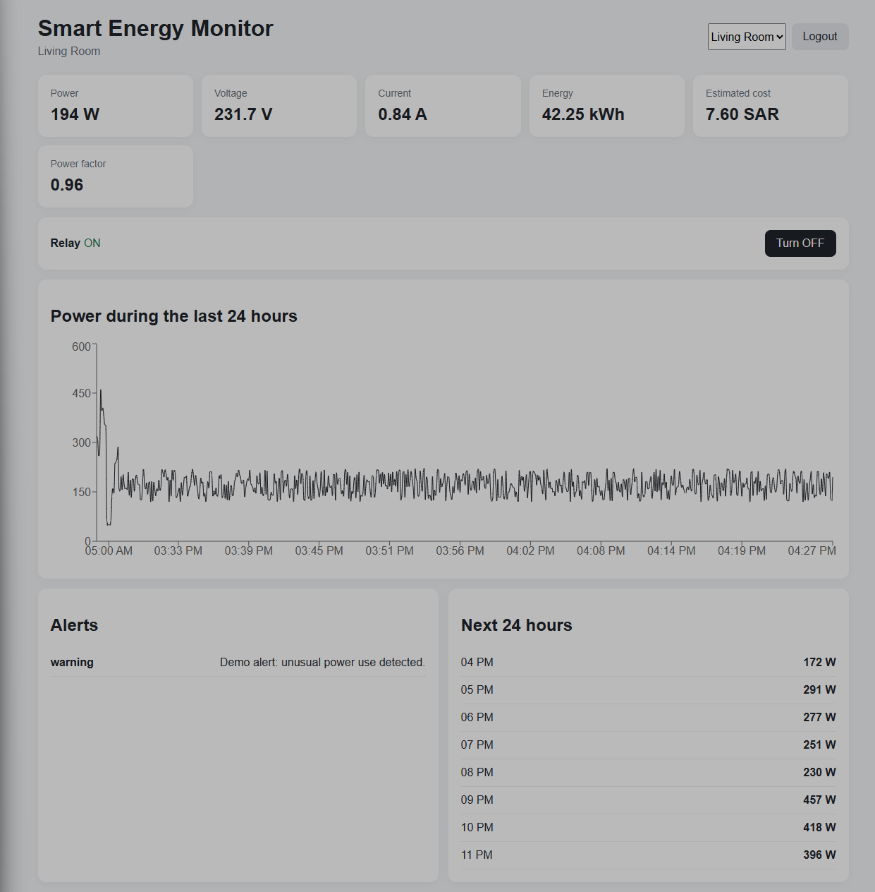

# Smart Energy Monitor

Smart Energy Monitor is a full-stack IoT project for monitoring electrical energy usage and controlling connected devices.

The system is designed to work with an ESP32 and a PZEM-004T energy meter. Measurements are sent over MQTT to a FastAPI backend, stored in PostgreSQL, and displayed through a React dashboard.

A built-in demo mode makes it possible to run and test the project without physical hardware.



## Features

- Monitor voltage, current, power, energy, and power factor
- View power usage over time
- Estimate electricity cost
- Control a relay remotely
- Detect unusually high power readings
- Generate a simple 24-hour usage forecast
- User authentication with JWT
- Store historical readings in PostgreSQL
- Run the complete system with Docker
- Test the application without hardware using demo mode

## System Overview

The project is divided into four main parts:

```text
PZEM-004T
    |
    v
  ESP32
    |
    | MQTT
    v
Mosquitto
    |
    v
FastAPI Backend
    |
    +------ PostgreSQL
    |
    v
React Dashboard
```

The ESP32 collects electrical measurements from the PZEM-004T and publishes them through MQTT.

The backend receives the readings, validates them, stores them in PostgreSQL, and provides API endpoints for the dashboard.

The dashboard reads the latest and historical data from the backend and allows the user to monitor consumption and control the relay.

## Tech Stack

| Area | Technologies |
| --- | --- |
| Frontend | React, TypeScript, Vite, Recharts |
| Backend | Python, FastAPI, SQLAlchemy |
| Database | PostgreSQL |
| IoT | ESP32, PZEM-004T |
| Messaging | MQTT, Eclipse Mosquitto |
| Authentication | JWT, Argon2 |
| Development | Docker, Docker Compose |
| Testing / CI | Pytest, GitHub Actions |

## Running the Project

### Requirements

Install Docker Desktop before running the project.

### 1. Clone the repository

```bash
git clone https://github.com/AbdulazizALDakhil/smart-energy-monitor.git
cd smart-energy-monitor
```

### 2. Create the environment file

On Windows:

```powershell
Copy-Item .env.example .env
```

Or simply run:

```text
start.bat
```

The startup script creates `.env` automatically if it does not already exist.

### 3. Start the application

```bash
docker compose up --build
```

Docker starts the following services:

```text
frontend
backend
database
mosquitto
```

### 4. Open the dashboard

```text
http://localhost:3000
```

FastAPI documentation is available at:

```text
http://localhost:8000/docs
```

## Demo Mode

Demo mode is enabled by default.

It generates sample energy readings so the complete application can be tested without connecting an ESP32 or PZEM-004T.

Demo account:

```text
Email: demo@smartenergy.local
Password: Demo123!
```

The generated data includes voltage, current, power, accumulated energy, power factor, alerts, and historical readings.

## Dashboard

The dashboard displays:

- Current power usage
- Voltage
- Current
- Total energy
- Estimated electricity cost
- Power factor
- Relay status
- Power history chart
- Usage alerts
- 24-hour forecast

The dashboard refreshes its data automatically while the application is running.

## Relay Control

The dashboard can send ON and OFF commands to a connected device.

The control flow is:

```text
Dashboard
    |
    v
FastAPI
    |
    v
MQTT
    |
    v
ESP32
    |
    v
Relay
```

When demo mode is enabled, the relay state is simulated by the backend.

## Energy Forecast

The project includes a simple 24-hour forecasting feature.

It uses previous power readings grouped by hour and calculates an average for each time period.

This is intentionally a lightweight forecasting method and is not presented as a machine-learning model.

## Alerts

The backend checks incoming power readings and can create an alert when a reading is significantly higher than normal.

Alerts are stored in the database and displayed on the dashboard.

## ESP32 Firmware

The firmware is located in:

```text
firmware/
```

The current pin configuration is:

```text
GPIO 26 -> Relay
GPIO 16 -> PZEM RX
GPIO 17 -> PZEM TX
```

Before uploading the firmware, copy:

```text
firmware/include/secrets.h.example
```

to:

```text
firmware/include/secrets.h
```

Then configure the Wi-Fi connection, MQTT server, and device ID.

The real `secrets.h` file is ignored by Git so Wi-Fi credentials are not uploaded to the repository.

## MQTT Topics

Energy readings are published to:

```text
energy/{device_id}/telemetry
```

Relay commands are published to:

```text
energy/{device_id}/command
```

Example:

```text
energy/1/telemetry
energy/1/command
```

## API

The backend provides endpoints for:

- User registration and login
- Device management
- Telemetry
- Historical readings
- Dashboard data
- Relay control
- Alerts
- Energy forecasting

Interactive API documentation is available through FastAPI Swagger UI at:

```text
http://localhost:8000/docs
```

## Testing

Backend tests are located in:

```text
backend/tests/
```

They cover the main application flow, including:

- User registration and login
- Authentication protection
- Device creation
- Telemetry storage
- Dashboard data

GitHub Actions also runs the backend tests and verifies that the frontend builds successfully whenever changes are pushed to the repository.

## Project Structure

```text
smart-energy-monitor/
|
|-- backend/
|   |-- app/
|   |-- tests/
|   |-- Dockerfile
|   `-- requirements.txt
|
|-- frontend/
|   |-- src/
|   |-- Dockerfile
|   `-- package.json
|
|-- firmware/
|   |-- include/
|   |-- src/
|   `-- platformio.ini
|
|-- mosquitto/
|   `-- mosquitto.conf
|
|-- docs/
|   |-- architecture.md
|   |-- code-style.md
|   |-- code-walkthrough.md
|   `-- dashboard.png
|
|-- .github/
|   `-- workflows/
|
|-- .env.example
|-- docker-compose.yml
|-- start.bat
|-- start.ps1
`-- README.md
```

## Current Status

The application currently runs successfully in Docker with:

- React frontend
- FastAPI backend
- PostgreSQL database
- Mosquitto MQTT broker
- Demo data generation
- Authentication
- Relay control
- Historical charts
- Alerts
- Forecasting

The ESP32 firmware is included for hardware integration, while demo mode allows the software side of the project to be tested independently.
